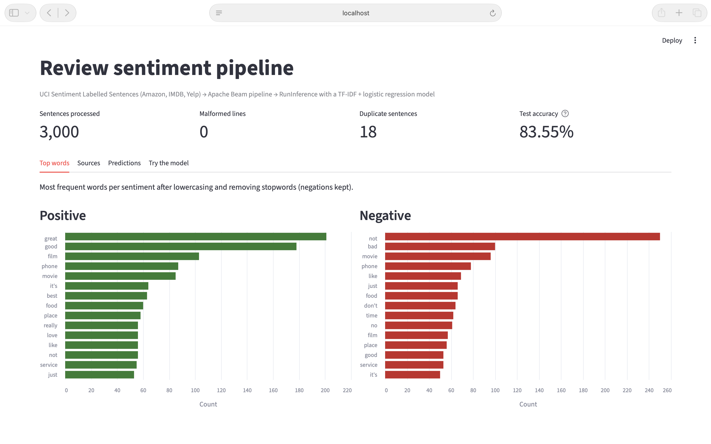
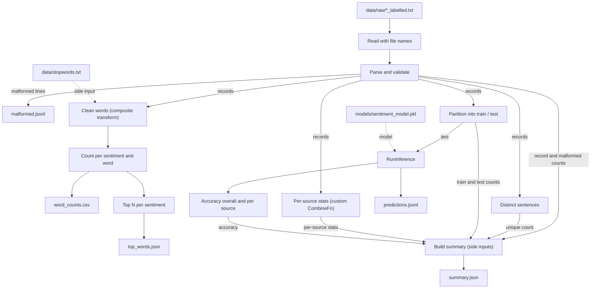
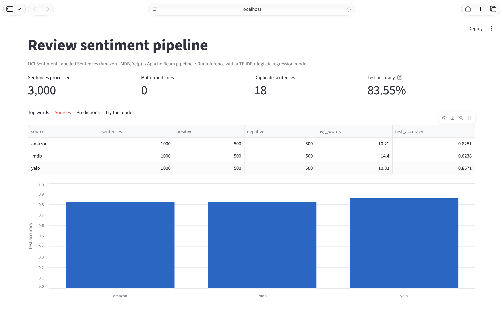
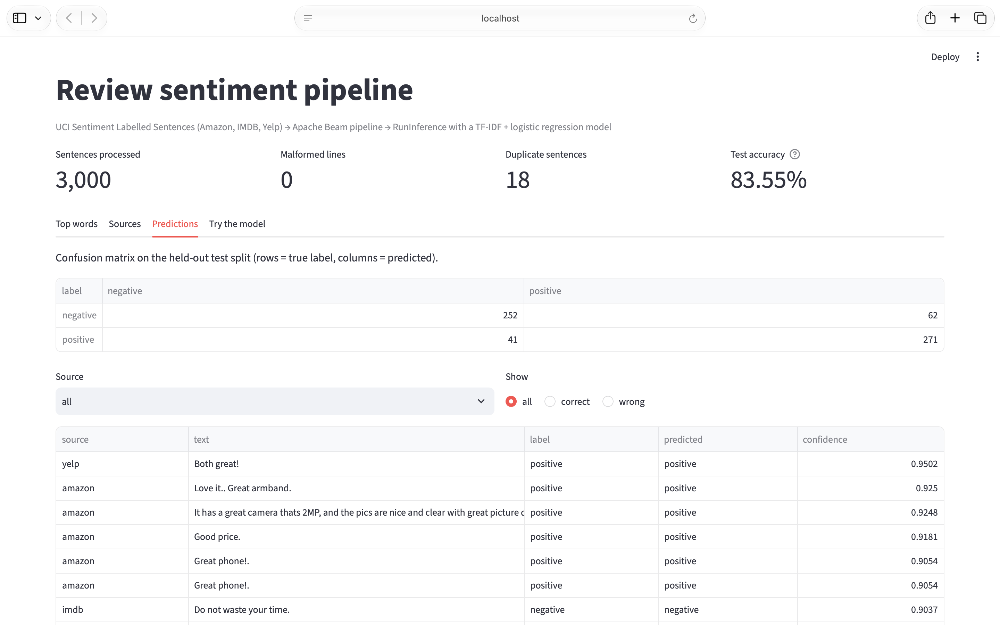
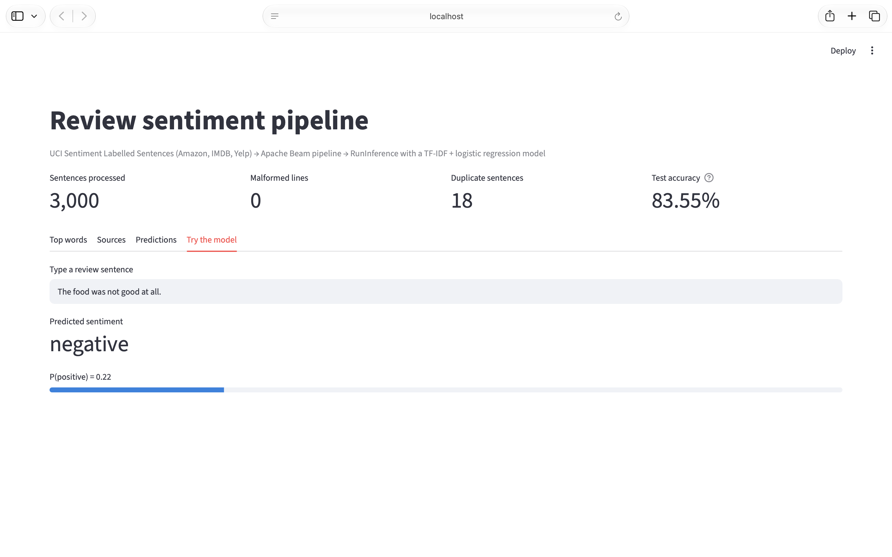

# Lab 3: Sentiment analysis pipeline with Apache Beam

For this lab I chose the Apache Beam lab from the course repo
([Labs/Data_Labs/Apache_Beam_Labs](https://github.com/raminmohammadi/MLOps/tree/main/Labs/Data_Labs/Apache_Beam_Labs)).
The original lab is a notebook that runs a word count over *King Lear*. I turned it into a Beam pipeline that
reads 3,000 labelled review sentences, validates them, analyzes the words per sentiment, runs a trained
sentiment model inside the pipeline with `RunInference`, and writes outputs that a Streamlit dashboard reads.



## What I changed

### The pipeline (the lab's core concept)

The original notebook builds one Beam pipeline: read lines, split them into words with a regex, pair each
word with 1, sum per word, and write the results as Python tuple strings. I kept that structure and extended it:

| Original notebook | My version |
|---|---|
| `ReadFromText('data/*')` | `ReadFromTextWithFilename`, so every sentence keeps its source (Amazon, IMDB, Yelp) |
| no validation | `ParDo` with a tagged output: bad lines go to a dead-letter file instead of crashing the run |
| `FlatMap` with the regex `[a-zA-Z']+` | `CleanWords`, a composite transform: same regex but lowercased with stray quotes stripped, stopwords removed through a side input, one-letter words dropped |
| `Map((word, 1))` + `CombinePerKey(sum)` | kept, but keyed by (sentiment, word), followed by `Top.PerKey` for the top words of each sentiment |
| none | a custom `CombineFn` that computes per-source stats (sentences, positive/negative, average words) |
| none | `Partition` into train/test, `RunInference` with the trained model on the test split, `Mean` for accuracy overall and per source |
| none | `Distinct` + `Count` to measure duplicate sentences |
| `Map(str)` + one `WriteToText` | JSON/CSV formatting and five output files, including a summary that joins the counts, per-source stats and accuracy through side inputs |
| hardcoded paths | command-line options (`--input`, `--top-n`, ...) through `argparse` + `PipelineOptions` |
| no tests | 11 tests: plain tests for the helpers, transform tests with Beam's `TestPipeline` and `assert_that`, and an end-to-end run |

It still runs locally on the DirectRunner like the original. In Beam 2.77 the DirectRunner hands the
pipeline to Prism, Beam's local runner, which is why Prism shows up in the logs.

### Dataset

- I replaced *King Lear* with the [UCI Sentiment Labelled Sentences](https://archive.ics.uci.edu/dataset/331/sentiment+labelled+sentences) dataset: 3,000 review sentences from Amazon, IMDB and Yelp, each labelled positive (1) or negative (0), with 500 of each per site.
- The three files are committed in `data/raw/` unchanged, so the data doesn't have to be downloaded (the original needed `gsutil` and the Google Cloud SDK to fetch its data).
- Two IMDB lines contain the invisible character `\x85`, most likely a Windows-1252 ellipsis (…) that was decoded wrongly. The parser turns it back into `...`.
- There are 3,000 rows but 2,982 unique sentences (18 rows repeat an earlier sentence), and no repeated sentence has conflicting labels. I kept the repeats, and the pipeline reports the count in its summary.
- The train/test split uses an md5 hash of each sentence, so every copy of a sentence lands on the same side and no sentence ends up in both train and test.

### Model

- The original lab has no model. I added a TF-IDF + logistic regression classifier (scikit-learn), trained by `src/train.py` on about 80% of the sentences (2,374; the hash split puts 626 in test).
- The TF-IDF uses single words and word pairs, so phrases like "not good" become their own feature.
- The Beam pipeline runs the model on the 626 held-out sentences with `RunInference`, using a custom inference function so it returns probabilities (shown as confidence scores).
- The pipeline's accuracy (0.8355) matches what `train.py` reports, which confirms both use the same split and the same model.

### Dashboard

- The original lab has no dashboard. I added a Streamlit app (`dashboard/app.py`) that reads the pipeline outputs and loads the trained model.
- At the top: sentences processed, malformed lines, duplicate sentences, and test accuracy.
- **Top words** tab: the most frequent words per sentiment after cleaning.
- **Sources** tab: per-source stats and test accuracy.
- **Predictions** tab: the confusion matrix, plus every test prediction with filters for source and for correct/wrong.
- **Try the model** tab: type any sentence and get the predicted sentiment and P(positive).

### Other changes

- The notebook is now plain Python scripts, so it runs without Jupyter and the transforms can be unit
  tested. The original notebook is kept unchanged in `original_lab/` for comparison.
- The packages the code imports directly are pinned in `requirements.txt` (the original had its `pip install` commented out).
- The stopword list (`data/stopwords.txt`) is scikit-learn's English list with negation words removed
  (no, not, never, ...). That matters here: after stopword removal, "not" is the most common word in negative sentences (250 times).

## How the pipeline works



## What you need

I tested this on macOS (Apple Silicon) with Python 3.12.16.

| Tool | Version | Notes |
|---|---|---|
| Git | any recent | to clone the repo |
| Python | 3.12 | the version I tested with; the pinned packages were resolved on it |
| Internet | | for `pip install`; Beam may also download its local runner (Prism) on the first pipeline run |

Python packages (installed during setup, pinned in `requirements.txt`):

| Package | Version |
|---|---|
| apache-beam | 2.77.0 |
| scikit-learn | 1.9.1 |
| streamlit | 1.66.1 |
| pandas | 3.1.0 |
| numpy | 2.4.6 |
| pytest | 9.2.0 |
| altair | 6.3.0 |

To install Python 3.12: on macOS, run `brew install python@3.12` (needs [Homebrew](https://brew.sh));
on Windows or Linux, use the installer from [python.org](https://www.python.org/downloads/).

To install Git: on macOS, run `xcode-select --install` (or `brew install git`); on Windows, use the installer from [git-scm.com](https://git-scm.com/downloads); on Linux, use your package manager.

## Setup

```bash
# 1. Get the code
git clone https://github.com/KD7789/mlops-lab3-kpd.git
cd mlops-lab3-kpd

# 2. Create a virtual environment with Python 3.12 and install the pinned packages
python3.12 -m venv .venv
source .venv/bin/activate
pip install --upgrade pip
pip install -r requirements.txt
```

On Windows (not tested), create and activate the venv with `py -3.12 -m venv .venv` and `.venv\Scripts\activate`.

If you use conda, run `conda deactivate` before activating the venv. `which python` should point to `.venv/bin/python`.

## Run it

Run everything from the repo root with the venv active, in this order.

### Step 1: train the model

```bash
python -m src.train
```

Expected output:

```
train rows: 2374 | test rows: 626
test accuracy: 0.8355
by source: {'amazon': 0.8251, 'imdb': 0.8238, 'yelp': 0.8571}
saved models/sentiment_model.pkl and models/metrics.json
```

### Step 2: run the Beam pipeline

```bash
python -m src.pipeline
```

It ends by printing the summary it wrote to `outputs/summary.json` (shown here with shorter formatting),
followed by `Outputs written to outputs/`:

```json
{
  "records": 3000,
  "malformed": 0,
  "unique_sentences": 2982,
  "duplicate_sentences": 18,
  "train_rows": 2374,
  "test_rows": 626,
  "test_accuracy": 0.8355,
  "test_accuracy_by_source": {"amazon": 0.8251, "imdb": 0.8238, "yelp": 0.8571},
  "sources": {
    "amazon": {"sentences": 1000, "positive": 500, "negative": 500, "avg_words": 10.21},
    "imdb": {"sentences": 1000, "positive": 500, "negative": 500, "avg_words": 14.4},
    "yelp": {"sentences": 1000, "positive": 500, "negative": 500, "avg_words": 10.83}
  }
}
```

### Step 3: run the tests (about 6 seconds on my machine)

```bash
python -m pytest -q
```

Expected: `11 passed`.

### Step 4: open the dashboard

```bash
streamlit run dashboard/app.py
```

It opens at http://localhost:8501. On the first run Streamlit may ask for an email in the terminal;
press Enter to skip. Stop it with Ctrl+C.

## What a successful run looks like

After steps 1 and 2 these files exist:

| File | What it contains |
|---|---|
| `models/sentiment_model.pkl` | the trained model |
| `models/metrics.json` | training metrics, confusion matrix, scikit-learn version |
| `outputs/summary.json` | totals, data-quality counts, split sizes, accuracy, per-source stats |
| `outputs/top_words.json` | top 15 words per sentiment |
| `outputs/word_counts.csv` | every (sentiment, word, count) after cleaning |
| `outputs/predictions.jsonl` | one line per test sentence: source, text, true label, prediction, confidence, correct |
| `outputs/malformed.jsonl` | lines that failed validation (empty for this dataset) |

`outputs/predictions.jsonl` has 626 lines and `outputs/malformed.jsonl` has 0.

The terminal also shows log lines that look alarming but are normal:

- `apitools not found, and bigquery client libraries are not available`: Beam checking for Google Cloud libraries this lab doesn't use.
- `Really starting service ... prism` and `Really destroying service ...`: Beam starting and stopping its local Prism runner.
- `Other threads are currently calling into gRPC, skipping fork() handlers` and `FD from fork parent still in poll list`: gRPC messages printed while Beam starts Prism.
- `Resource module is not available for current platform, memory usage cannot be fetched`: Beam can't read memory usage on this platform; it doesn't affect the results.

The dashboard shows 3,000 sentences, 0 malformed lines, 18 duplicates and 83.55% test accuracy, with a
confusion matrix of 252 / 62 / 41 / 271 (true negative / false positive / false negative / true positive):

| Top words | Sources |
|---|---|
|  |  |

| Predictions | Try the model |
|---|---|
|  |  |

## Project structure

```
mlops-lab3-kpd/
├── data/
│   ├── raw/                 # the 3 UCI files, unchanged
│   ├── stopwords.txt        # scikit-learn stopwords minus negations
│   └── README.md            # data source, citation, license
├── src/
│   ├── __init__.py          # makes src a package
│   ├── common.py            # parsing, tokenizing, train/test split (shared)
│   ├── train.py             # trains and saves the model
│   ├── transforms.py        # Beam building blocks: DoFn, composite transform, CombineFn, inference helpers
│   └── pipeline.py          # the Beam pipeline
├── tests/test_pipeline.py   # 11 tests
├── dashboard/app.py         # Streamlit dashboard
├── docs/screenshots/        # dashboard screenshots
├── original_lab/            # the original notebook, unchanged, for comparison
├── requirements.txt
└── pytest.ini
```

`models/` and `outputs/` are created by steps 1 and 2 (they're git-ignored).

## Pipeline options

| Option | Default | What it does |
|---|---|---|
| `--input` | `data/raw/*_labelled.txt` | files to read |
| `--stopwords` | `data/stopwords.txt` | stopword list used as a side input |
| `--model` | `models/sentiment_model.pkl` | model used by `RunInference` |
| `--output-dir` | `outputs` | where the five output files go |
| `--top-n` | `15` | how many top words per sentiment |
| `--min-word-len` | `2` | shorter words are dropped from the word counts |

Any other flags are passed to Beam (for example `--runner=DirectRunner`).
Example: `python -m src.pipeline --top-n 25`.

## Troubleshooting

- `Model not found at models/sentiment_model.pkl`: run step 1 first.
- The dashboard shows "Missing: ...": run steps 1 and 2 first.
- The shell can't find `python3.12`: install Python 3.12 (see "What you need").
- Port 8501 already in use: `streamlit run dashboard/app.py --server.port 8502`.

## Data source and license

Kotzias, D. (2015). Sentiment Labelled Sentences [Dataset]. UCI Machine Learning Repository.
https://doi.org/10.24432/C57604. Licensed under CC BY 4.0; see `data/README.md`.
